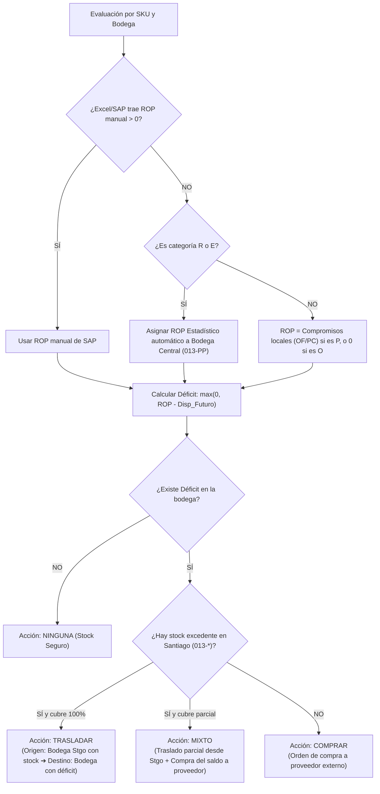

> **OBSOLETO (27-oct-2026).** Describe el DRP por bodega (COMPRAR / TRASLADAR / MIXTO). Lo
> reemplaza SPEC-11 (una compra por artículo para la red + traslados). El motor descrito sigue
> corriendo solo como "escenario actual" del panel de indicadores (SPEC-15, SPEC-18).

# Documentación Técnica & Operativa: Motor S&OP REPO + DRP de Abastecimiento

**Proyecto:** Sistema de Proyección y Recomendación de Compras S&OP  
**Cliente / Empresa:** Pesco S.A.  
**Versión:** 2.0 (Motor Slim4 + REPO + DRP Integrado)  
**Fecha:** Agosto 2026  

---

## 1. Resumen Ejecutivo

Este módulo implementa el nuevo estándar de aprovisionamiento de Pesco S.A., combinando:
1. **Matriz Slim4:** Segmentación (Pañol 95% vs Repuestos), Clasificación ABC (año móvil), Artículos Nuevos e Inmovilizados.
2. **Nomenclatura REPO Pesco:** Clasificación dinámica mensual en 4 categorías operativas (`R`, `E`, `P`, `O`) homologadas con los códigos SAP (`VB`, `V1`, `PD`, `ND`).
3. **Cálculo Estadístico de ROP:** Determinación matemática de Stock Mínimo, Stock de Seguridad y Punto de Reorden (ROP) basada en el consumo real de los últimos 12 meses, lead time y nivel de servicio.
4. **Motor DRP de Balanceo Híbrido:** Algoritmo de redistribución de inventario que prioriza traslados internos desde bodegas centrales de Santiago (`013-*`) hacia sucursales, evitando compras redundantes a proveedores externos.
5. **Dashboard Ejecutivo Gerencial:** Panel para gerencia con KPIs, gráficos históricos de disponibilidad, evolución de materiales a pedido y ranking de quiebres por días.

---

## 2. Nomenclatura REPO (Mapeo Pesco ↔ Slim4 / SAP)

| Código Pesco | Código SAP/Slim4 | Nombre Categoría | Criterio de Asignación | Política de Reabastecimiento |
|---|---|---|---|---|
| **`R`** | **`VB`** | **Rotación** | Consumo en **$\ge 2$ meses** distintos en el año móvil. | Cálculo automático de **ROP Estadístico** (Stock Mínimo + Stock de Seguridad). |
| **`E`** | **`V1`** | **Estratégico** | Insumo crítico de taller / Pañol 95% con política `SI_STOCK` fija. | **Stock Mínimo Fijado** (mantiene disponibilidad operativa para faenas críticas). |
| **`P`** | **`PD`** | **A Pedido** | Sin rotación regular, pero tiene **Orden de Fabricación (OF) o Pedido de Cliente (PC) activo**. | **Compra bajo pedido estricto**: $ROP = \text{Compromisos activos}$. No acumula stock. |
| **`O`** | **`ND`** | **Obsoleto** | Sin salidas en $> 12$ meses y sin pedidos/OF activas. | **Bloqueo total de compras** ($ROP = 0$). Alerta de descontinuación / liquidación. |

---

## 3. Fórmulas de ROP y Parámetros Estadísticos

Para todo material clasificado como **`R`** o **`E`**, el sistema construye el vector de consumo de los últimos 12 meses ($M_1, M_2, \dots, M_{12}$):

### 3.1. Consumo Promedio Mensual ($\bar{C}$)
$$\bar{C} = \frac{1}{12} \sum_{i=1}^{12} C_i$$

### 3.2. Desviación Estándar Muestral ($\sigma_m$)
$$\sigma_m = \sqrt{\frac{\sum_{i=1}^{12} (C_i - \bar{C})^2}{11}}$$

### 3.3. Lead Time en Meses ($LT_m$)
$$LT_m = \frac{\text{Lead Time (días)}}{30}$$

### 3.4. Stock Mínimo (Demanda en Tiempo de Entrega + Colchón)
$$\text{Stock Mínimo} = (LT_m + 0.25) \times \bar{C}$$
*(El $+0.25$ corresponde a 1 semana extra de revisión/gestión administrativa).*

### 3.5. Stock de Seguridad ($SS$)
$$SS = \sqrt{LT_m} \times \sigma_m \times Z$$

* **Factor $Z$ según Nivel de Servicio:**
  * Pañol Operativo / Crítico: $Z = 1.65$ ($95\%$ de disponibilidad).
  * Repuestos Clase A: $Z = 1.28$ ($90\%$ de disponibilidad).
  * Repuestos Clase B: $Z = 1.04$ ($85\%$ de disponibilidad).
  * Repuestos Clase C: $Z = 0.84$ ($80\%$ de disponibilidad).

### 3.6. Punto de Reorden ($ROP$)
$$\mathbf{ROP = \lceil \text{Stock Mínimo} + SS \rceil}$$

### 3.7. Stock Máximo Sugerido
$$\mathbf{\text{Stock Máximo} = ROP + (3 \times \bar{C})}$$

---

## 4. Motor DRP de Balanceo Híbrido (Traslados vs Compras)

El motor resuelve automáticamente el problema de compras innecesarias cuando hay stock en otras bodegas:

### Reglas de Bodegas Donantes (Santiago):
* **Bodegas Centrales:** `013-PP` (Pañol Producción Stgo), `013-PS` (Pañol Servicios Stgo), `013-07` (Stgo Ambulancia), `013-09` (Stgo Semiremolque).
* **Bodegas Sucursales:** `002-02` (Antofagasta), `003` (Copiapó), `008` (Los Ángeles), `010` (Puerto Montt), `002` (Calama).

---

## 5. Estructura del Dashboard Ejecutivo Gerencial (`/dashboard/gerencial/`)

Diseñado según la minuta de requerimientos de la gerencia:
1. **Gráfico 1:** `% Disponibilidad Histórica Mensual` por sucursal (gráfico de líneas Chart.js).
2. **Gráfico 2:** `Inventario Total por Sucursal (Unidades)` (gráfico de líneas Chart.js).
3. **Módulo 3:** Tabla de `SKUs en Quiebre Activo` ordenados de mayor a menor por días estimados de quiebre ($\text{Días} = \frac{\text{Unidades en quiebre}}{\text{DPD}}$).
4. **Gráfico 4:** `Evolución Mensual de Materiales a Pedido` (consumo en OFs cerradas + despachos PC).
5. **Módulo 5:** `Ranking de Materiales a Pedido [P]` ordenados del más caro al más barato por valor total de inventario ($\text{Stock} \times \text{Costo USD}$).
6. **Módulo 6 (Aviso pendiente):** `Ranking de Solicitantes por Inventario a Pedido` (pendiente de ingesta del N° de OF en Solped).

---

## 6. Archivos Modificados y Creados

* `apps/inventory/models.py`: Incorporación de campos REPO en `SKUClassification` y campos DRP en `StockProjection`.
* `apps/inventory/migrations/0007_add_repo_classification_and_drp_fields.py`: Migración de base de datos.
* `apps/inventory/classification_engine.py`: Motor S&OP integrado (Slim4 + REPO + DRP de balanceo y ROP estadístico).
* `apps/purchasing/views.py`: Filtros y métricas KPI de REPO y tipo de acción (Comprar/Trasladar/Mixto).
* `templates/purchasing/list.html`: Columnas REPO y Acción DRP con detalle de origen y destino (`desde X ➔ hacia Y`).
* `apps/inventory/views.py`: Inclusión de `transfer_source_warehouse` en la ficha de detalle de SKU.
* `templates/inventory/sku_detail.html`: Tarjeta de diagnóstico REPO y tabla de bodegas con acción DRP explícita. *(Eliminada en SPEC-20: la ficha del artículo es la de la Calculadora.)*
* `apps/dashboard/urls.py` y `apps/dashboard/views.py`: Endpoints y vista del Reporte Gerencial.
* `templates/dashboard/executive_report.html`: Template del panel gerencial.
* `templates/base.html`: Enlace de navegación "Gerencial".
